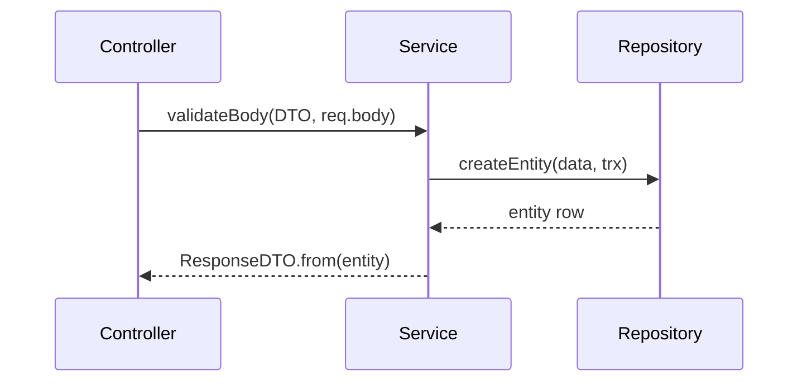

# Diagram Engineering and Technical Documentation

## Purpose

Choose the right diagram type and tool, produce maintainable diagram sources, and integrate them with prose that explains the architecture — without inventing components.

## When to Use

Any task that creates, edits, or reviews a diagram in `Docs/`; choosing between Mermaid, D2, PlantUML, Structurizr, or Excalidraw; fixing a diagram that fails to render.

## Core Principles

- The diagram must answer one question for one audience. If it needs a paragraph to justify its existence, split or delete it.
- Prefer text-based sources committed next to the docs; they diff, review, and age like code.
- Tool choice follows purpose, audience, and renderer — never familiarity. A small flowchart does not need C4/Structurizr; a presentation sketch does not need PlantUML.
- Diagrams never replace prose: source, render, explanation, and references are four distinct artifacts.
- Accuracy over completeness: a smaller true diagram beats a comprehensive fictional one.

## Quick Bite Project Rules

- Default to inline Mermaid fences in `Docs/` — GitHub renders them, no build step exists, and all current docs use `flowchart`, `stateDiagram-v2`, and `erDiagram`.
- Mermaid syntax constraints learned the hard way in this repo: no nested `[`/`]` inside node labels, no `&`/`->` inside labels, no ` ` in state descriptions, unique node IDs per diagram, quoted subgraph titles.
- Docs homes: contracts in `Docs/API Contracts/`, flows in `Docs/business-logic/`, system views in `Docs/system-design/`. Place the diagram with its explanatory section; cross-link, don't duplicate.
- Use real names only — modules, classes, files, endpoints, tables, event types from the code. Mark unverified parts **Undetermined**.
- Never redraw accurate existing diagrams just to switch tools; never add a rendering pipeline or dependency for one diagram.

## Tool Selection Guide

| Need | First choice | When to escalate |
| --- | --- | --- |
| Process/endpoint/auth/cache flows | Mermaid `flowchart` | D2 when layout quality or theming materially matters (needs CLI render + committed SVG) |
| Lifecycles and status machines | Mermaid `stateDiagram-v2` | PlantUML state when composite/concurrent states are required |
| ER / schema ownership | Mermaid `erDiagram` | Visual editor or PlantUML when manual layout is essential |
| Call sequences (controller→service→repo, cache hit/miss, webhooks, outbox) | Mermaid `sequenceDiagram` | PlantUML sequence for activation boxes, grouping, and teoz timing |
| System context, containers, dependencies | Mermaid `flowchart` + subgraphs | Structurizr + C4 only when maintaining several related views from one model pays off |
| Whiteboard/presentation quality, manual placement | Excalidraw — commit the `.excalidraw` JSON scene as the editable source alongside any exported image | — |

How to confirm syntax: open the tool's diagram-type page directly (Mermaid sidebar under Diagram Syntax, D2 tour, PlantUML per-diagram pages) or paste into the Live Editor / Playground — never trust remembered syntax.

## Common Mistakes

- Decoration diagrams that restate the heading without clarifying a relationship, flow, or lifecycle.
- One giant diagram with crossing edges instead of two or three small ones (split by logical section).
- Presenting a proposed/illustrative diagram as current behavior.
- Committing a rendered PNG without its editable source.
- Copying a response shape from a sibling endpoint into a diagram instead of the actual projection.

## Recommended Approach

1. State the question and audience in one sentence.
2. Read the source of truth (routes, services, repos, schemas, config).
3. Pick the simplest diagram type, then the tool per the table above.
4. Write the source honoring repo syntax constraints; keep labels short and readable.
5. Place it in the existing docs home with prose covering: what it shows, why it matters, boundaries, failure paths, current-vs-proposed, and assumptions.
6. Validate: render via Live Editor/Playground/CLI when possible; if rendering can't be verified, say so explicitly.
7. Report files, tool + reason, validation performed, and remaining limits.

## Examples

Cache-hit sequence, outbox publish/consume flow, and OTP lifecycle all follow this pattern: participants are real code units, messages are real calls.

## Verification Checklist

- [ ] One question, one audience, simplest fitting type.
- [ ] Source committed in repo convention (inline Mermaid or source + image).
- [ ] Renders (or unrendered status stated); no syntax pitfalls.
- [ ] Every named element exists in code; assumptions marked.
- [ ] Prose explains interpretation, not a transcript of boxes.

## References

- Mermaid intro + diagram syntax — https://mermaid.js.org/intro/ ; Live Editor — https://mermaid.live/ ; Mermaid CLI — https://mermaid.js.org/config/mermaidCLI.html
- GitHub creating diagrams with Mermaid — https://docs.github.com/en/get-started/writing-on-github/working-with-advanced-formatting/creating-diagrams
- D2 tour + docs — https://d2lang.com/tour/intro/ ; D2 sequence diagrams and shapes — https://d2lang.com/
- PlantUML sequence — https://plantuml.com/sequence-diagram ; PlantUML state — https://plantuml.com/state-diagram ; Language reference — https://pdf.plantuml.net/PlantUML_Language_Reference_Guide_en.pdf
- Structurizr DSL tutorial — https://docs.structurizr.com/dsl/tutorial ; DSL reference — https://docs.structurizr.com/dsl/language
- Excalidraw + developer docs — https://excalidraw.com/ ; https://docs.excalidraw.com/
