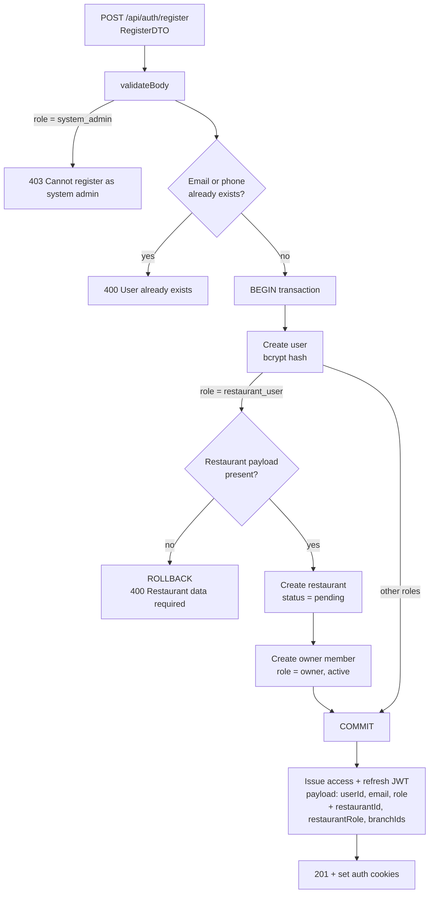
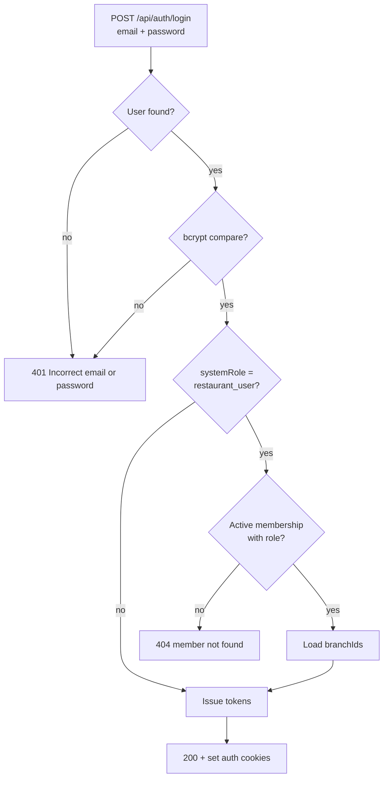
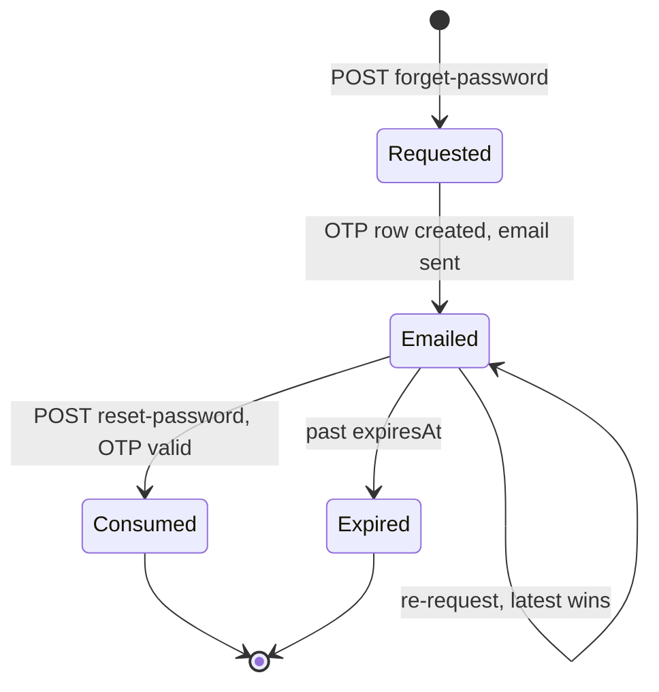
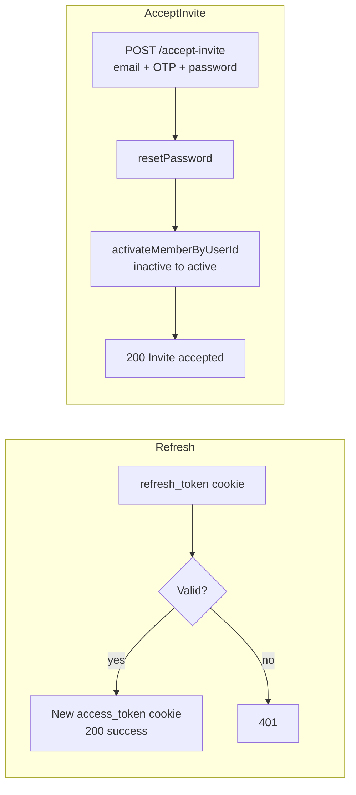

# QuickBite `core-service` — Auth Business Logic

Identity, registration, login, password recovery and invitation acceptance live in `src/app/auth` (`controller/auth.controller.ts`, `service/auth.service.ts`).

## 1. Registration Flow (`POST /api/auth/register`)

Key rules (`service/auth.service.ts:31`):
1. `system_admin` can never self-register (`cannotSingUpAsSystemAdminError`).
2. Email/phone uniqueness is checked **before** the transaction to save resources.
3. Restaurant owners are created atomically: `users` → `restaurants` → `restaurant_members(owner/active)` in one `db.transaction`. Any failure rolls everything back.
4. The JWT for a `restaurant_user` embeds `restaurantId`, `restaurantRole` and `branchIds` so downstream guards (`requireRestaurantMember`, `requireBranchAccess`, `rbac`) work without extra lookups.

## 2. Login Flow (`POST /api/auth/login`)

Security notes:
- Unknown email and wrong password return the **same** 401 (`incorrectCredentialsError`) — no account enumeration (`auth.service.ts:94`).
- Restaurant users must have an `active` membership; otherwise login fails even with correct credentials.

## 3. Password Recovery (OTP) Lifecycle

Rules (`auth.service.ts:126`):
1. `forget-password` **always returns success**, even for unknown emails — enumeration protection.
2. OTPs are stored as hashes (`hashOTP`); only the latest row per user is evaluated (`findLatestPasswordResetByUserId`).
3. `reset-password` requires the OTP to match **and** be unexpired and unconsumed, then updates the password hash and marks the row consumed (`updatePasswordResetConsumedAt`).
4. New passwords must satisfy the strong-password policy (8+ chars, upper, lower, number).

## 4. Refresh & Invitations

- Refresh only rotates the **access** token; the refresh token is long-lived and re-verified each call (`auth.service.ts:161`).
- Invited members are created with `status = inactive` and empty passwords; `accept-invite` reuses the reset-password OTP machinery, then flips the membership to `active` (`member.service.ts:46`, `auth.service.ts:168`).
