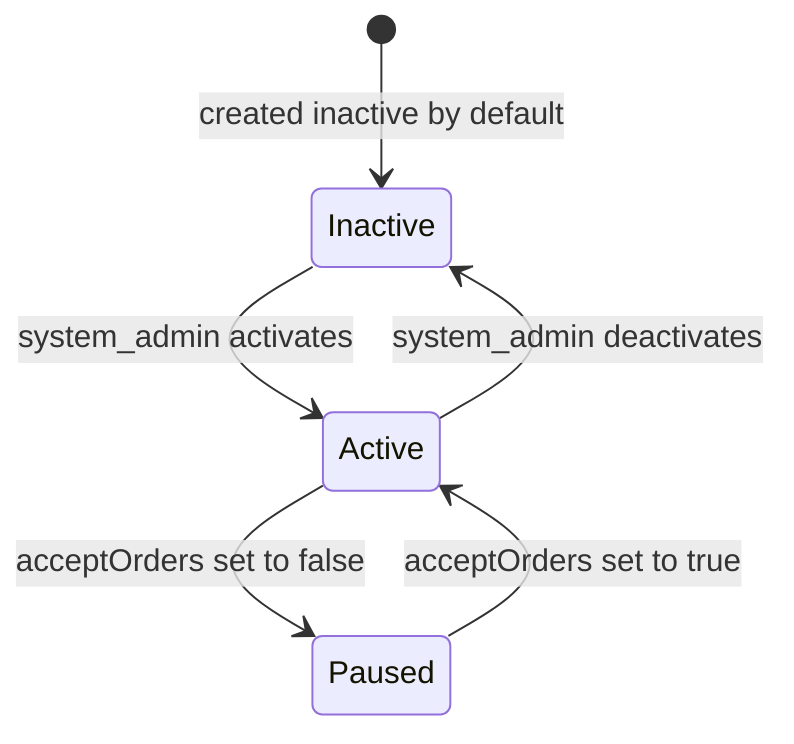
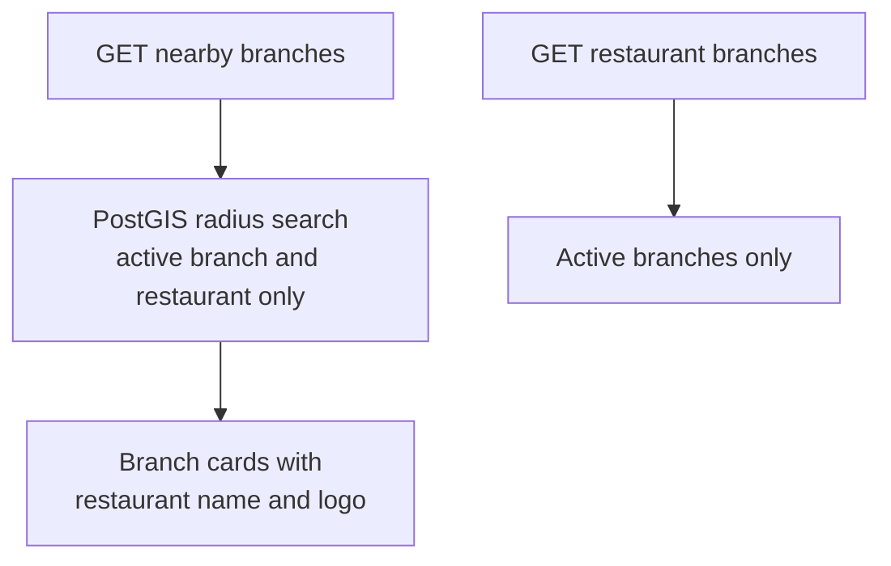
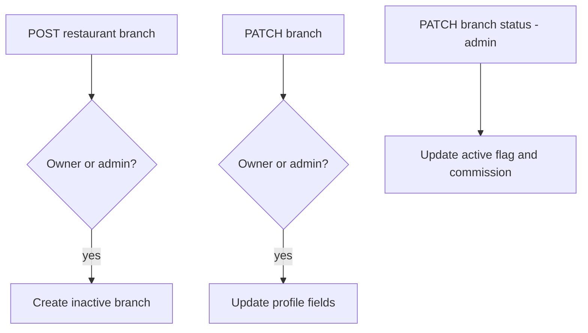
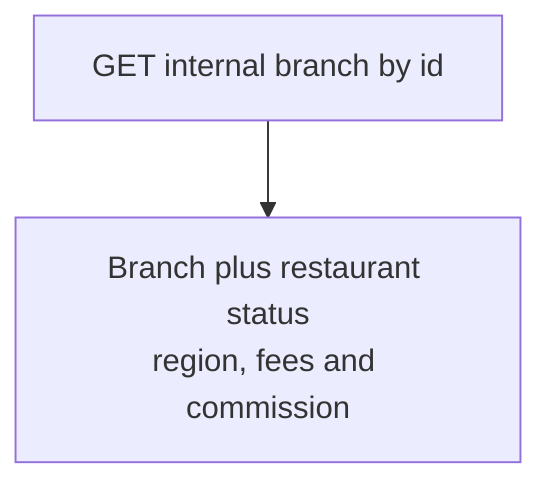

# QuickBite `core-service` — Branch Business Logic

Branches are the operational units of a restaurant: geolocation, delivery radius, ordering switches and commission. Code in `src/app/branch` (`service/branch.service.ts`, PostGIS queries in `repository/branch.repo.ts`).

## 1. Branch Operating State

- New branches start **inactive** — they are invisible to the storefront until an admin activates them (`branch.service.ts:30`).
- `isActive` (admin-controlled) and `acceptOrders` (operational pause) are independent switches; storefront queries require both, plus an `active` restaurant.

## 2. Endpoint Flows

### 2.1 Storefront (public)

### 2.2 Management (auth plus RBAC)

### 2.3 Service-to-service (internal API key)

Rules:
1. **Nearby search is geo-fenced.** `findNearbyBranches` joins `restaurant_branches` to `restaurants` and filters `b.is_active AND r.status = 'active' AND ST_DWithin(location, point, delivery_radius * 1000)` over a GIST index (`repository/branch.repo.ts:56`).
2. **Money is minor units.** `deliveryFee` is stored in minor currency units; `commission` is a branch-level rate number updated only via the admin status endpoint.
3. **Duplicate route caveat.** `GET /restaurants/:restaurantId/branches` is registered twice; the active-only handler wins and the all-branches handler is unreachable (see API contract).
