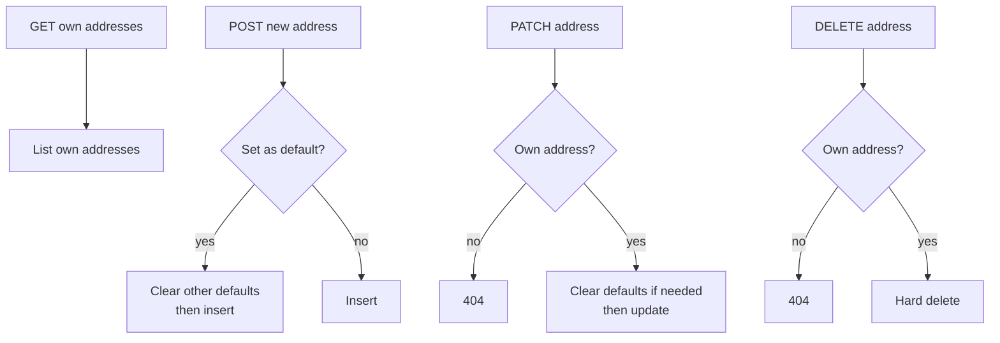
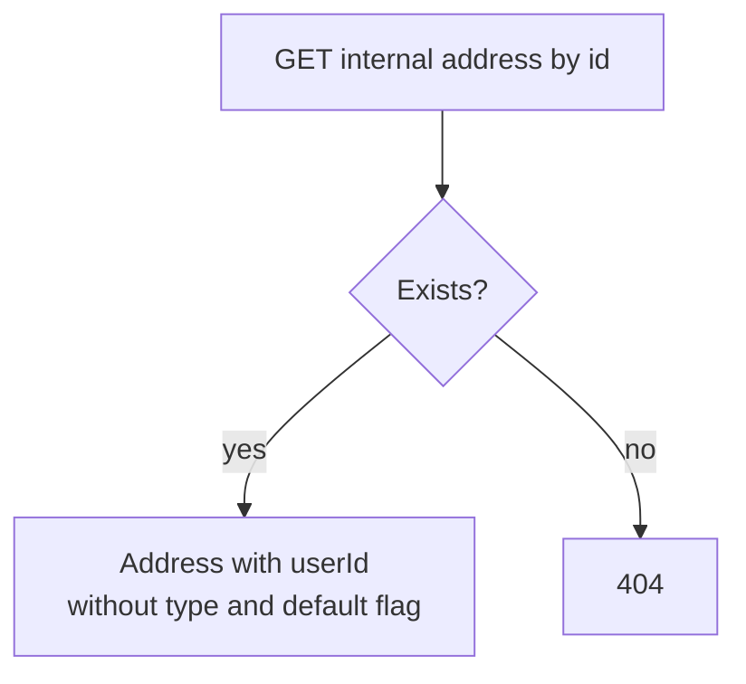
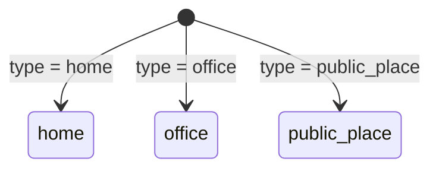

# QuickBite `core-service` — Customer Address Business Logic

Saved delivery addresses live in `src/app/customer-address` (`service/customer-address.service.ts`). Every address belongs to exactly one user (`customer_addresses.user_id`).

## 1. Endpoint Map

### 1.1 Customer (authentication required)

### 1.2 Service-to-service (internal API key)

## 2. Business Rules

1. **Ownership is enforced on every mutation.** `update`/`remove` load via `findAddressByIdAndUserId(addressId, userId)` — a user can never touch another user's address; the result is 404 either way (`customer-address.service.ts:57`).
2. **Exactly one default per user (best-effort).** When a create/update sets `isDefault: true`, `clearDefaultByUserId` flips all other addresses to `false` first (`customer-address.service.ts:47`). Concurrent requests could interleave — there is no unique partial index backing this invariant.
3. **Deletes are hard deletes.** `deleteAddress` issues a SQL `DELETE` (`repository/customer-address.repo.ts:122`); no `deleted_at`, no recovery.
4. **Response shapes differ by surface.** Customer-facing create/update return the `toResponse` projection (no `userId`/timestamps, includes `type` + `isDefault`); the internal `getById` returns `{ id, userId, label, country, city, street, building, apartmentNumber, lat, lng }` and omits `type`/`isDefault`. See `Docs/API Contracts/customer-address.md`.

## 3. Address Types

`AddressType` (`entity/enums.ts`) is a plain label for the customer app — it drives no server-side behavior today.
