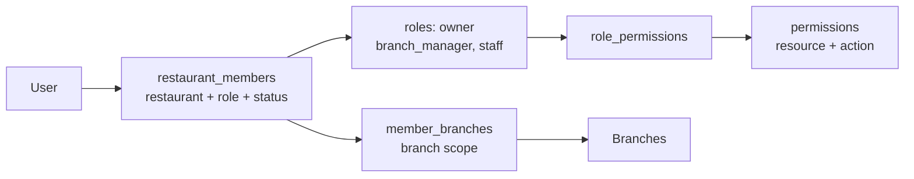
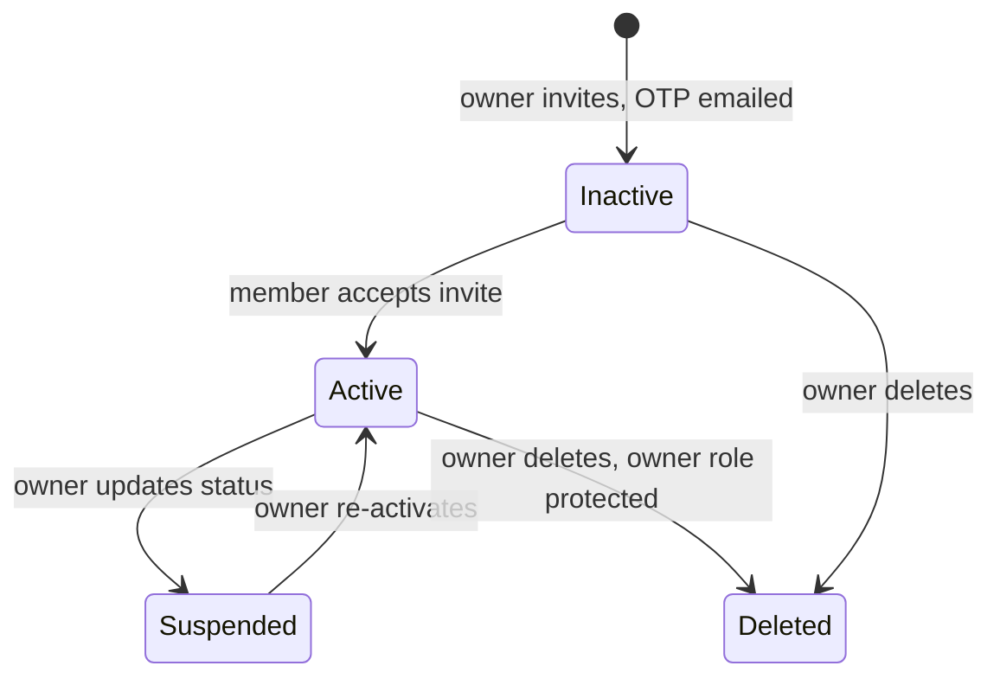
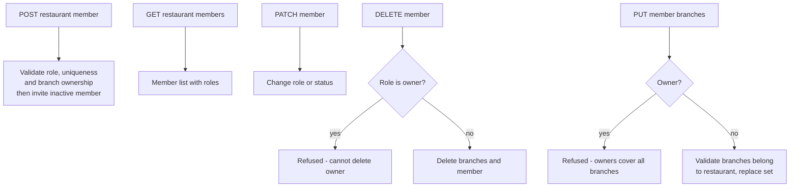
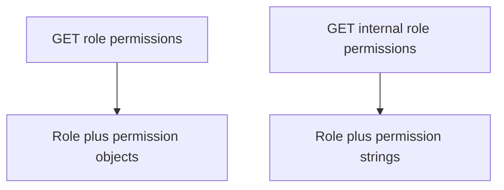

# QuickBite `core-service` — RBAC & Members Business Logic

Restaurant membership, roles and permissions live in `src/app/rbac` (`service/member.service.ts`). Three seeded roles — `owner`, `branch_manager`, `staff` — gate every management endpoint through the `rbac({ resource, action })` middleware.

## 1. Permission Model

Seeded matrix (`migrations/..._seed_rbac_data.ts`):

| Permission | owner | branch_manager | staff |
| --- | --- | --- | --- |
| `core:product:create/read/update` | ✅ | ✅ | read-only* |
| `core:member:create/update/delete` | ✅ | — | — |
| `core:member:read` | ✅ | ✅ | — |
| `core:branch:create/update` | ✅ | update only | — |
| `core:restaurant:update` | ✅ | — | — |

\* staff seeded permissions are read-oriented; owners hold all 10 permissions.

## 2. Member Lifecycle

## 3. Endpoint Flows

### 3.1 Members (auth plus member checks)

### 3.2 Permissions (public and internal)

Rules:
1. **Owners are special.** Nobody can create an `owner` member or delete/branch-scope one (`cannotCreateOwnerMember`, `cannotDeleteOwnerError`, `cannotAssignBranchesToOwners`).
2. **Branch assignments are allow-lists.** Non-owners see only assigned branches via `requireBranchAccess`; every assignment is verified with a single `COUNT` query that all `branchIds` belong to the restaurant (`member.service.ts:194`).
3. **Public vs internal permission shapes differ.** The public endpoint returns `{ permission: "resource:action" }` objects; the internal one returns plain `"resource:action"` strings for order-service.
