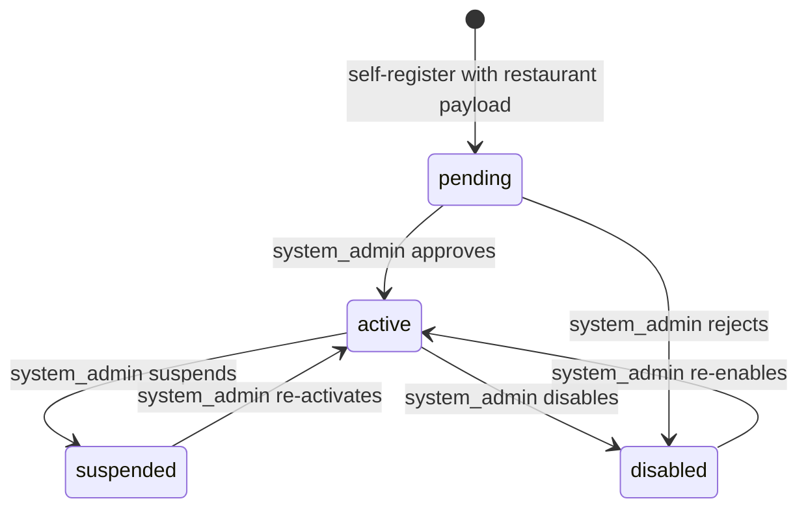
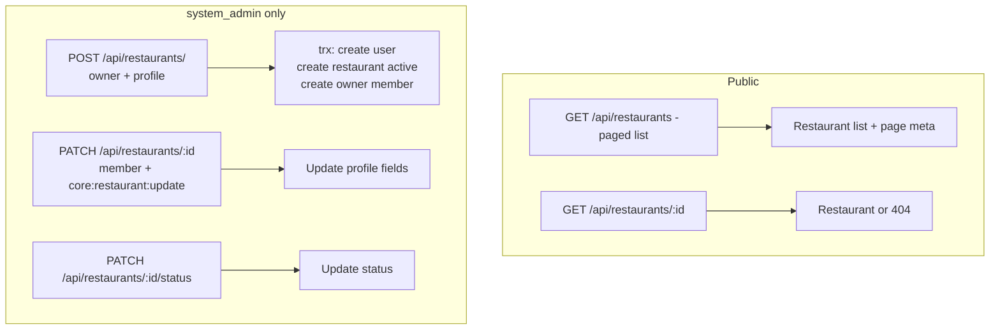

# QuickBite `core-service` — Restaurant Business Logic

Restaurant profiles live in `src/app/restaurant` (`service/restaurant.service.ts`). A restaurant is the aggregate root for branches, products, categories and members.

## 1. Restaurant Status State Machine

- Only `system_admin` may change status (`updateStatus`, `restaurant.service.ts:117`); every transition stamps `status_updated_at`.
- Status gates the storefront: `findNearbyBranches` only serves branches whose restaurant is `active`.
- Note: the controller also defines `getActive`, but no route in `restaurant.routes.ts` registers it, so it is currently unreachable. The event type `restaurant.suspended` is defined in `EVENT_TYPES` but never written to the outbox by current code — only `product.stock.changed` is emitted (see `Docs/system-design/system-design.md` §4).

## 2. Endpoint Flows

Rules:
1. **Two creation paths, one invariant.** Self-registration creates the restaurant as `pending`; admin creation (`createWithOwner`) creates it as `active` with its owner user + owner membership in a single transaction (`restaurant.service.ts:24`).
2. **Owner check on branch writes.** Branch create/update verify `restaurant.ownerId == userId` (or admin) in the service layer (`branch.service.ts:30`), independent of the route guards.
3. **Listing is cursor-paginated behind a DTO gatekeeper.** `GET /` validates all query params through `ListRestaurantsQueryDTO` (`extends BasePaginationQueryDTO`) via `validateQuery` — string casting (`"25"` → `25`), CSV splitting (`"1,2,3"` → `[1,2,3]`), and allowlisting happen there; any invalid value returns 400 before the service runs. Accepts `limit` (default 20, max 100) / `cursor` / `sortBy ∈ [createdAt,name,status]` / `sortOrder` plus `id|status|name` filters, and returns `{ data, meta: { nextCursor, hasMore, count } }`. Services/repositories receive typed `PaginationParams`/`FilterParams` only.
4. **Unreachable handler.** `RestaurantController.getActive` has no route registration, so it serves no traffic despite existing in code.
