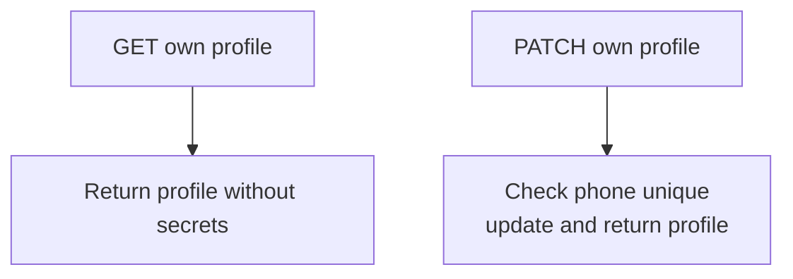
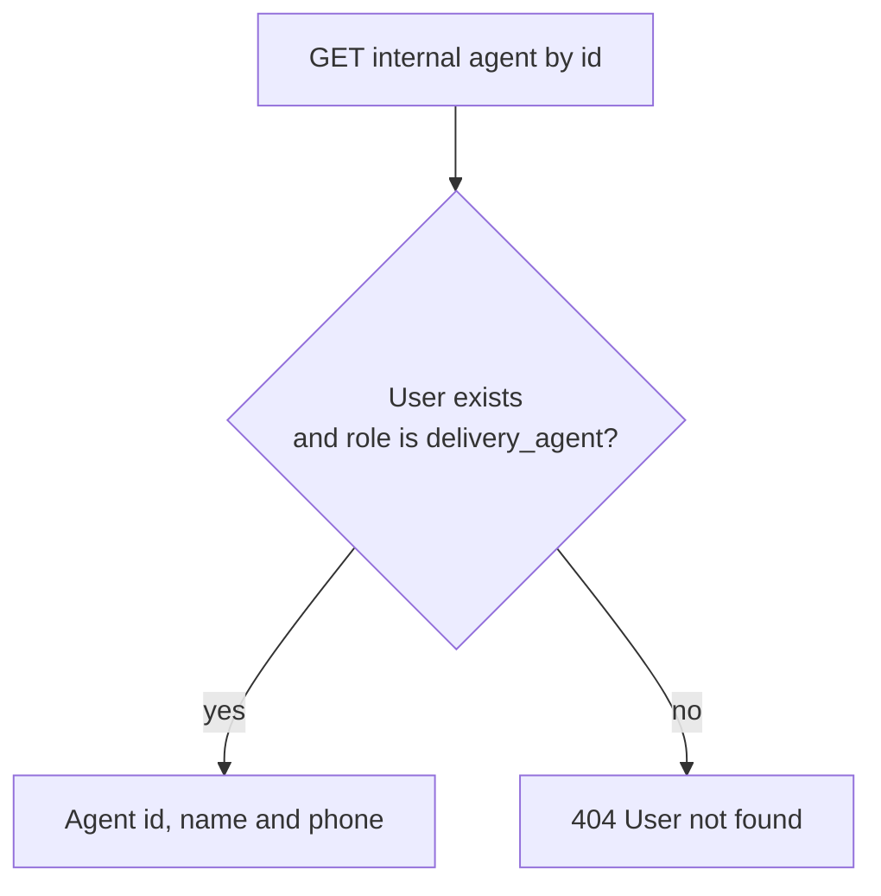
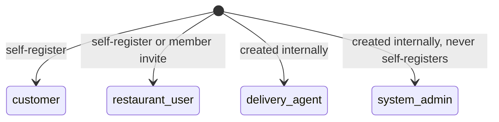

# QuickBite `core-service` — User Business Logic

Profile management lives in `src/app/user` (`controller/user.controller.ts`, `service/user.service.ts`). The `users` table is the identity root every other module references.

## 1. Endpoint Map

### 1.1 Self service (authentication required)

### 1.2 Service-to-service (internal API key)

## 2. Business Rules

1. **Profile reads never expose secrets.** `getByUserId` returns `toUserResponse()` (`lib/utils/utils.ts:3`) — `{ id, email, phone, name, systemRole, createdAt, updatedAt }`. `passwordHash` and `deletedAt` never leave the service.
2. **Phone changes are uniqueness-guarded.** `updateProfile` checks `findUserExistsByPhone` before writing; a taken phone returns the phone-in-use error (`user.service.ts:48`). Email is immutable — there is intentionally no endpoint to change it.
3. **Soft-deleted users are invisible.** All `find*` queries filter `deleted_at IS NULL` (`repository/users.repo.ts:34`).
4. **Agent lookup is enumeration-safe.** `getAgentById` returns 404 both when the user is missing **and** when the user exists but is not a `delivery_agent` (`user.service.ts:58`), so callers (order-service dispatch) cannot probe other user types.

## 3. System Roles

Roles are stored on `users.system_role` (`customer | restaurant_user | system_admin | delivery_agent`) and embedded in every JWT, driving the `authentication` guard and all RBAC checks.
