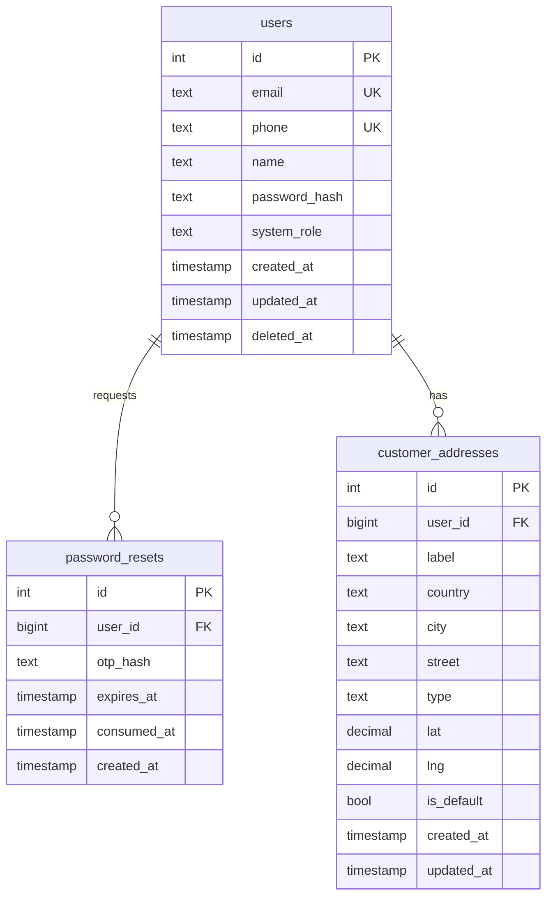
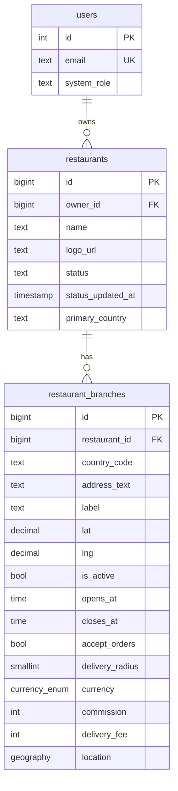
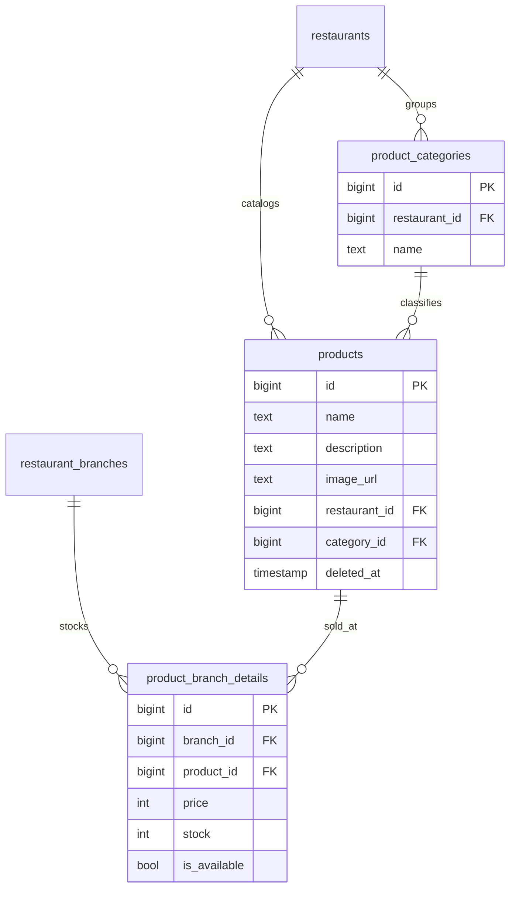
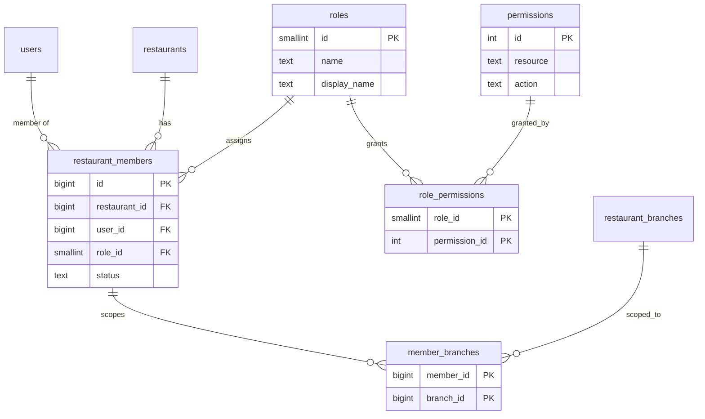
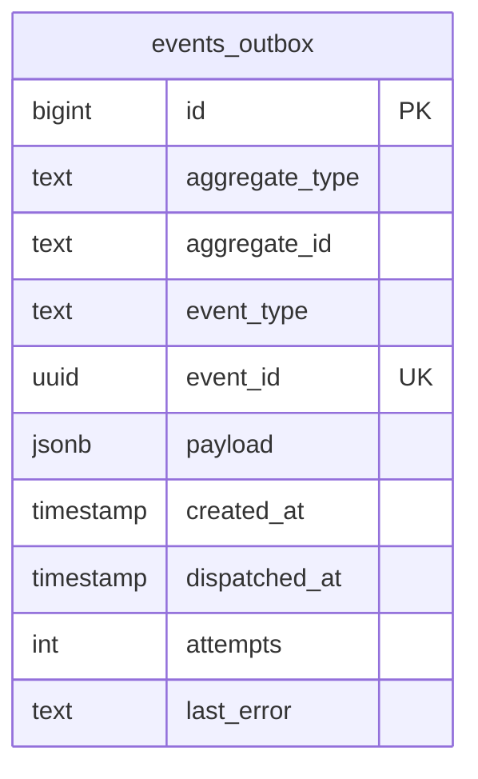

# QuickBite `core-service` — Database Design Specification

Derived from `src/migrations/*.ts`, repository column lists and entity classes. Conventions mirror order-service: tables are plural `snake_case`, money in integer minor units, enums as `TEXT CHECK(...)` (plus one Postgres `ENUM` for currency).

## 1. Entity-Relationship Diagrams

Split by domain so each diagram stays readable. All relationships and columns match the table specifications in section 2.

### 1.1 Identity

### 1.2 Restaurants and branches

### 1.3 Catalog

### 1.4 RBAC

### 1.5 Outbox (standalone, no foreign keys)

## 2. Table Specifications

### 2.1 `users` — identity root
`id SERIAL PK`, `email/phone UNIQUE NOT NULL`, `password_hash`, `system_role CHECK(customer, restaurant_user, system_admin, delivery_agent)`, `created_at/updated_at`, `deleted_at` (soft delete; all finds filter it). Indexes: `email`, `system_role`.

### 2.2 `password_resets` — OTP ledger
`id`, `user_id FK`, `otp_hash` (plain OTPs never stored), `expires_at` (+10m), `consumed_at`, `created_at`. Only the latest unconsumed row counts.

### 2.3 `customer_addresses`
`id`, `user_id FK`, `label/country/city/street/building/apartment_number`, `type CHECK(home, office, public_place)`, `lat/lng`, `is_default`, timestamps. Single-default-per-user is enforced in service code, not by constraint.

### 2.4 `restaurants`
`id BIGSERIAL PK`, `owner_id FK → users`, `name`, `logo_url`, `status CHECK(active, disabled, suspended, pending)`, `status_updated_at`, `primary_country`. Indexes: `owner_id`, `status`, `primary_country`, `created_at`.

### 2.5 `restaurant_branches` — PostGIS-enabled
As in the ER diagram, plus `delivery_fee` (minor units, added by later migration) and the generated `location geography(point, 4326)` column with a `GIST` index powering `ST_DWithin` nearby search. `delivery_radius` is km (`SMALLINT`); the query multiplies by 1000.

### 2.6 Catalog: `product_categories`, `products`, `product_branch_details`
- Categories unique per `(restaurant_id, name)`.
- Products soft-deletable (`deleted_at`); FK to restaurant + nullable category.
- `product_branch_details` unique per `(branch_id, product_id)`; `price/stock INT`, `is_available BOOL`. The `trg_product_after_insert` trigger seeds zeroed rows for all sibling branches on product insert.

### 2.7 RBAC: `roles`, `permissions`, `role_permissions`, `restaurant_members`, `member_branches`
- `roles`: `owner`, `branch_manager`, `staff` (seeded).
- `permissions`: `(resource, action)` unique pairs (`core:product:*`, `core:member:*`, `core:branch:*`, `core:restaurant:update`).
- `restaurant_members`: unique `(restaurant_id, user_id)`, `status CHECK(active, inactive, suspended)`, FKs to restaurant/user/role with cascading deletes.
- `member_branches`: composite PK `(member_id, branch_id)`, cascade on both sides.

### 2.8 `events_outbox` — transactional outbox
`id BIGSERIAL PK`, `aggregate_type/aggregate_id`, `event_type` (`product.stock.changed`, `product.price.changed`, `branch.updated/deactivated`, `restaurant.suspended`, `rbac.permissions_changed`), `event_id UUID UNIQUE`, `payload JSONB`, `created_at`, `dispatched_at NULL until published`, `attempts`, `last_error`. Partial index on pending rows drives the worker scan. Note: only `product.stock.changed` currently has a write call site (`product.service.ts:195`); the other types are defined but not yet emitted.
