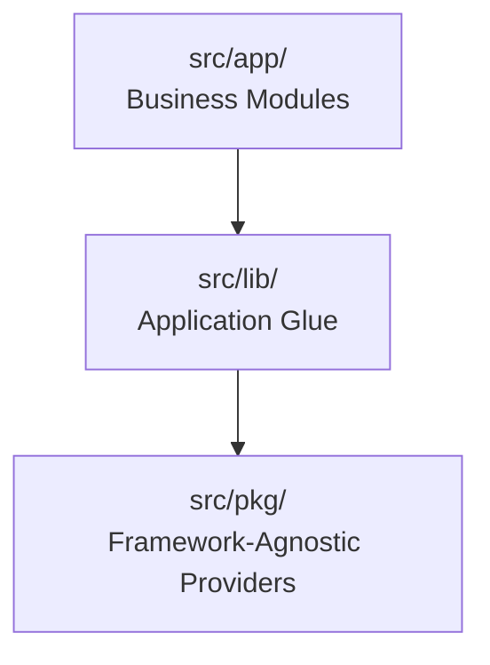

# QuickBite `core-service` — Folder Structure & Architecture Rules

## 1. Directory Tree Overview

```
core-service/
├── Docs/                           # Architecture, schemas, contracts & business logic
│   ├── API Contracts/              # Per-module endpoint contracts
│   │   ├── auth.md
│   │   ├── branch.md
│   │   ├── customer-address.md
│   │   ├── health.md
│   │   ├── product.md
│   │   ├── rbac.md
│   │   ├── restaurant.md
│   │   └── user.md
│   ├── business-logic/             # Domain flows and business rules
│   │   ├── auth.md
│   │   ├── branch.md
│   │   ├── customer-address.md
│   │   ├── health.md
│   │   ├── product.md
│   │   ├── rbac.md
│   │   ├── restaurant.md
│   │   └── user.md
│   └── system-design/              # Platform-level design
│       ├── system-design.md
│       ├── database-design.md
│       └── folder-structure.md
├── src/
│   ├── app.ts                      # Express application factory (/api mount)
│   ├── server.ts                   # HTTP bootstrap + graceful shutdown
│   ├── worker.ts                   # Outbox drain cron (independent process)
│   ├── routes.ts                   # Master router mounting all module routers
│   ├── app/                        # Business/Domain modules
│   │   ├── auth/                   # Register/login/OTP/invites
│   │   │   ├── controller/ dto/ entity/ repository/ service/ templates/
│   │   ├── user/                   # Profiles + internal agent lookup
│   │   ├── customer-address/       # Saved delivery addresses
│   │   ├── restaurant/             # Restaurant profiles + status
│   │   ├── branch/                 # Branches + geo search
│   │   ├── product/                # Categories, products, branch stock
│   │   ├── rbac/                   # Members, roles, permissions
│   │   │   └── templates/          # member-invitation.ts
│   │   └── health/                 # Liveness probe
│   ├── lib/                        # Application-aware infrastructure & glue
│   │   ├── auth/                   # guard, rbac, api-key middlewares (guard.ts, rbac.ts,
│   │   │                           #   api-key.ts, errors.ts)
│   │   ├── cache/                  # Redis init + withCache middleware
│   │   │                           #   (init.ts, with.cache.ts, cache.service.ts)
│   │   ├── config/                 # Validated environment configuration
│   │   ├── correlation/            # X-Correlation-ID tracing
│   │   ├── di/                     # TSyringe container + tokens
│   │   ├── email/                  # Mail provider wiring (init.ts)
│   │   ├── error/                  # AppError, ValidationError, handler
│   │   ├── events/                 # Outbox repo, drain, types, broker init
│   │   │                           #   (event-types.ts, init.ts, outbox-drain.ts,
│   │   │                           #    outbox.repo.ts, types.ts)
│   │   ├── http/                   # Response envelopes + pagination
│   │   │   └── pagination/         # cursor-pagination.ts (keyset helpers, decodeCursor,
│   │   │                         #   buildFilterParams), base-query.dto.ts (shared list-query
│   │   │                         #   contract)
│   │   ├── idempotency/            # Redis/DB idempotency middleware
│   │   ├── knex/                   # Knex connection manager + knexfile
│   │   ├── logger/                 # Structured logger
│   │   ├── types/                  # Ambient Express typings (req.user…)
│   │   ├── utils/                  # toUserResponse + shared mappers (utils.ts),
│   │   │                         # query-transforms.ts (CSV @Transforms),
│   │   │                         # case.ts (camelToSnake)
│   │   └── validation/             # validateBody/Params/Query + errors
│   ├── pkg/                        # Pure, framework-agnostic providers
│   │   ├── cache/                  # Redis provider + interface (cache.interface.ts, redis.ts)
│   │   ├── email/                  # Mailjet client + interface (email.interface.ts, mailjet.ts)
│   │   ├── messaging/              # RabbitMQ client abstraction
│   │   │                           #   (message-broker.interface.ts, rabbitmq.client.ts)
│   │   └── utils/                  # Pure helpers (time.ts)
│   └── migrations/                 # PostgreSQL migrations (users → outbox)
│       ├── 20260802131643_create_users_table.ts
│       ├── 20260802150955_create_password_resets_table.ts
│       ├── 20260802153223_create_customer_addresses_table.ts
│       ├── 20260813162440_create_restaurants_table.ts
│       ├── 20260813162536_create_restaurant_branches_table.ts
│       ├── 20260819110728_create_products_tables.ts
│       ├── 20260822073536_create_rbac_tables.ts
│       ├── 20260822082721_seed_rbac_data.ts
│       ├── 20261011014324_seed_order_service_permissions.ts
│       ├── 20261011014411_create_events_outbox.ts
│       └── 20261011014521_add_delivery_fee_to_branches.ts
├── package.json
└── tsconfig.json
```

Each domain module follows the same inner layout:

```
src/app/<module>/
├── controller/       # Express handlers (thin: validate → service → respond)
├── service/          # Business logic + transactions (TSyringe injectable)
├── repository/       # Knex queries, column projections, row→entity mappers
├── entity/           # Domain classes + enums (no framework imports)
├── dto/              # *.request.dto.ts (class-validator input)
│                     # *.response.dto.ts (static from() output)
│                     # *.query.dto.ts (list endpoints: extends BasePaginationQueryDTO,
│                     #                module filter + toFilterParams(), via validateQuery)
├── *.routes.ts       # Router + guard chain
└── *.errors.ts       # Module AppError constants
```

---

## 2. Layering Boundaries & Import Rules



1. **`src/pkg/`** — MUST NOT import from `src/lib` or `src/app`; MUST NOT read `process.env`; no Express/Knex concepts.
2. **`src/lib/`** — May import `src/pkg/` + config; MUST NOT import domain entities/DTOs/controllers from `src/app/` (sole exception: `src/lib/di/container.ts` wiring injectables at startup).
3. **`src/app/`** — May import `src/lib/` and `src/pkg/`; a module MUST NOT import another module's repository directly — cross-module reads go through services (e.g. `AuthService` → `UserService`/`RestaurantService`/`MemberService`) or domain events.

---

## 3. Cross-Cutting Conventions

- **DI:** TSyringe `@injectable()` services/ controllers, tokens in `lib/di/tokens.ts`, resolved in routes files.
- **Validation:** `validateBody` (strict) vs `validateParams`/`validateQuery` (explicit `@Type` coercion — implicit conversion is `tsc`-only); list-query DTOs (`extends BasePaginationQueryDTO` in `lib/http/pagination/`, CSV transforms in `lib/utils/query-transforms.ts`) fail fast with `ValidationError { errors: [{ field, message }] }` (400).
- **Responses:** `sendSuccess` / `sendPaginated` envelopes, except documented raw bodies (see API Contracts).
- **Money:** integer minor units everywhere (`deliveryFee`, `price`, `stock` counts as INT).
- **Events:** same-transaction `events_outbox` inserts; `worker.ts` drains to `core.events` for order-service.
