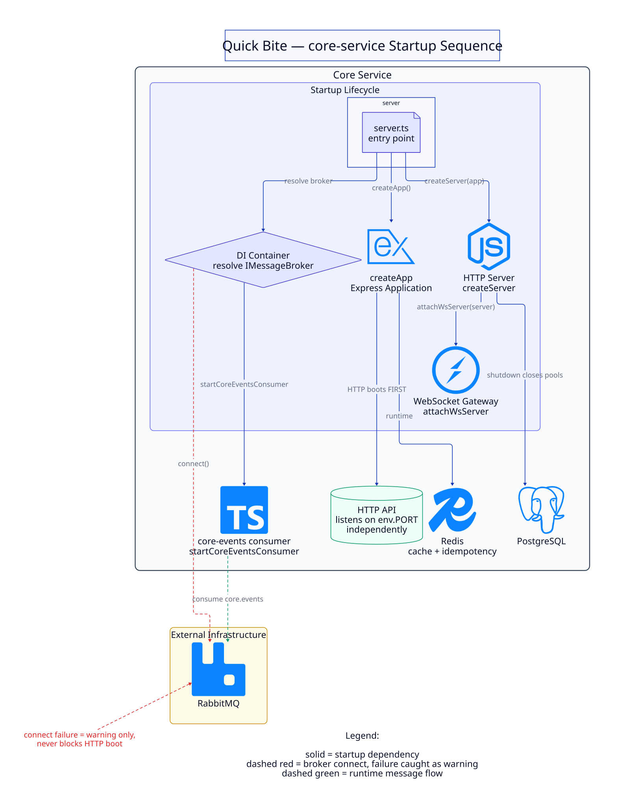

# Startup Architecture — core-service boot sequence

How the entry point (`src/server.ts`) opens the HTTP surface and starts the event
consumer pipeline. Companion to `event-driven-architecture.md` (the runtime event flow);
this page covers only process bootstrap.

Diagram source: [`diagrams/core-service-startup.d2`](diagrams/core-service-startup.d2) —
rendered with [D2](https://d2lang.com) (`d2 --layout elk <source> <output>`). Logos are
Simple Icons SVGs embedded at render time under [`diagrams/icons/`](diagrams/icons/).

## What the diagram shows

**Boundaries**

- **Core Service → Startup Lifecycle** — everything that happens inside the boot script.
- **HTTP API** (cylinder) — the listening surface on `env.PORT`.
- **External Infrastructure** — RabbitMQ, the one service the boot touches over the network.

**Startup chain (solid arrows)**

1. `server.ts` calls `createApp()` — builds the Express application.
2. `server.ts` wraps it with `node:http` `createServer(app)`.
3. The WebSocket gateway (`attachWsServer`) attaches to the same HTTP server.
4. The DI container resolves `IMessageBroker` (`TOKENS.MessageBroker`).

**Failure-tolerant broker connection (dashed red)**

- `DI → RabbitMQ: connect()` is wrapped in `.catch` — a broker failure at boot is
  **logged as a warning only** (`Core events consumer start warning`). The HTTP API is
  not blocked by it and still starts listening. This is the deliberate decoupling that
  lets a RabbitMQ outage degrade event delivery without degrading the API.

**Runtime message flow (dashed green)**

- After connect, `startCoreEventsConsumer` subscribes to the `core.events` queue and
  stays running for the process lifetime. That membership is runtime, not boot state —
  the consumer channel's setup re-runs on every reconnect, so topology and subscription
  recover automatically after a broker restart.

## Related

- Runtime pipeline details (dedup, handlers, DLQ): `event-driven-architecture.md`.
