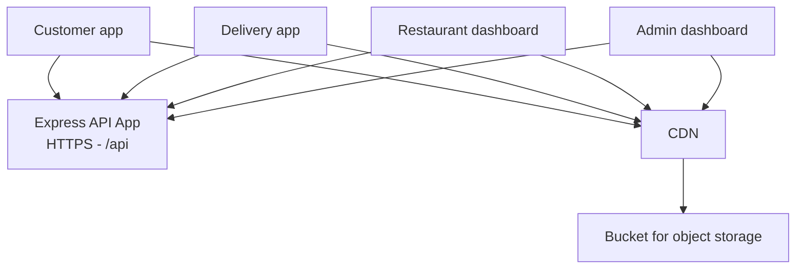
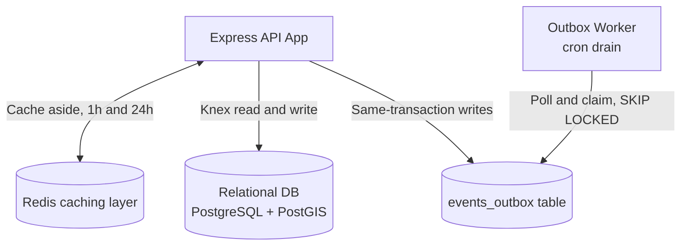
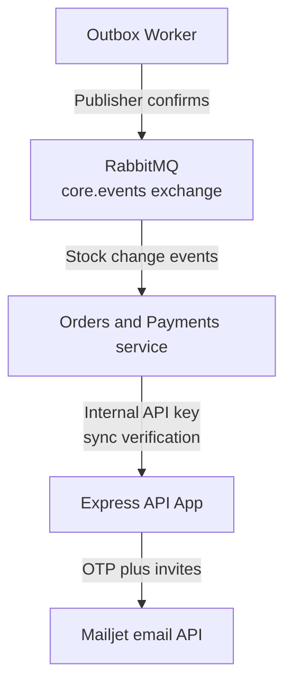
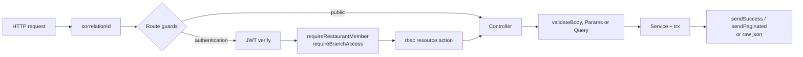
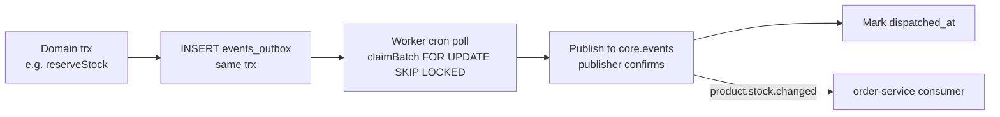

# QuickBite `core-service` — System Design Document

## 1. Architectural Overview & Context

`core-service` is the system of record for identity, catalog and access control. It owns users, restaurants, branches, products, addresses and RBAC, and serves both public clients and order-service (sync internal APIs + async domain events).

The overview is split into three focused diagrams: client traffic, data layer, and service integration. Together they carry the same information as the platform diagram (`order-service/Docs/System Design/img_2.jpg`).

### 1.1 Client traffic

Clients talk to the API over HTTPS; static media is served from the CDN bucket, never from the API.

### 1.2 Data layer

Redis is cache-only and the database is authoritative. Domain transactions write their outbox rows in the same transaction; the worker later claims and publishes them.

### 1.3 Service integration

Only `product.stock.changed` is currently written to the outbox (`product.service.ts:195`); the remaining `EVENT_TYPES` values are defined but have no write call sites yet. See §4.

---

## 2. Request Lifecycle

- Public storefront reads skip auth; management writes stack `authentication → scope → rbac`.
- Internal routes swap the whole chain for `requireInternalApiKey` (pre-shared key, no JWT).

---

## 3. Caching Strategy (Redis and In-Process)

| Key pattern | Store / TTL | Freshness mechanism |
| --- | --- | --- |
| Branch / product projections (`withCache`) | Redis, 1h (404s: 5m) | TTL expiry only — no explicit eviction call sites in current code |
| RBAC permission sets (`role_permissions:*`) | In-process memory, 1h (`PermissionCacheService`) | Explicit `invalidateRolePermissions` method exists but has no callers yet |
| Idempotency keys | Redis, 1 day | TTL expiry |

`withCache(toSec(...))` wraps storefront GETs. The outbox worker's channel lets order-service evict its own `core:*` projections, but today only `product.stock.changed` rows are ever published — plan TTLs accordingly.

---

## 4. Asynchronous Messaging (Transactional Outbox)

API instances never publish directly — rows are claimed by N parallel workers without duplicates, and failures stay pending with `attempts`/`last_error` for retry.

Note: `EVENT_TYPES` also defines branch, restaurant, and RBAC event names, but `product.stock.changed` (written by `reserveStock`) is currently the only type with a write call site.

---

## 5. Email (Mailjet)

OTP delivery (`passwordResetEmail`) and member invitations (`memberInvitationEmail`) go through the `IEmailProvider` abstraction (`pkg/email`). Auth flows send inside/after the inviting transaction so a missed email never leaves a half-created member.

---

## 6. Deployment & Scaling Notes

- Two processes: `server` (HTTP API) and `worker` (outbox drain) — scale API horizontally; workers scale too via `SKIP LOCKED` claiming.
- PostgreSQL carries PostGIS (GIST geo index) and the `location` generated column; Redis is cache-only (DB is authoritative).
- Graceful shutdown closes HTTP + destroys Knex pool (`server.ts:16`).
