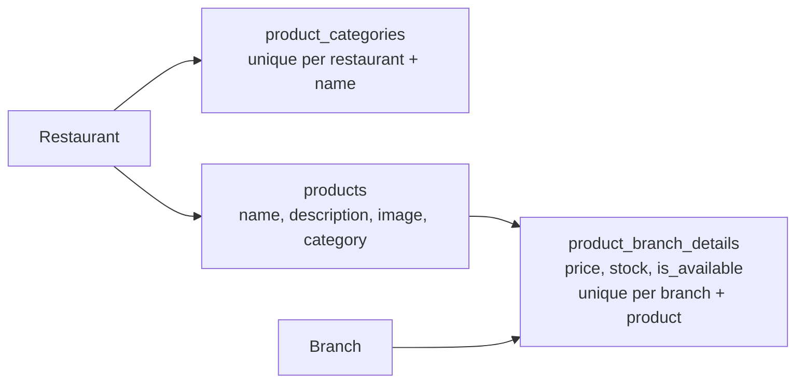
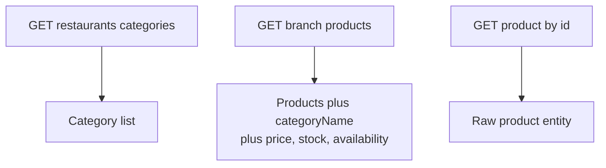
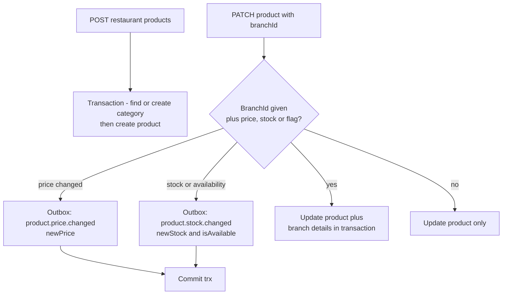
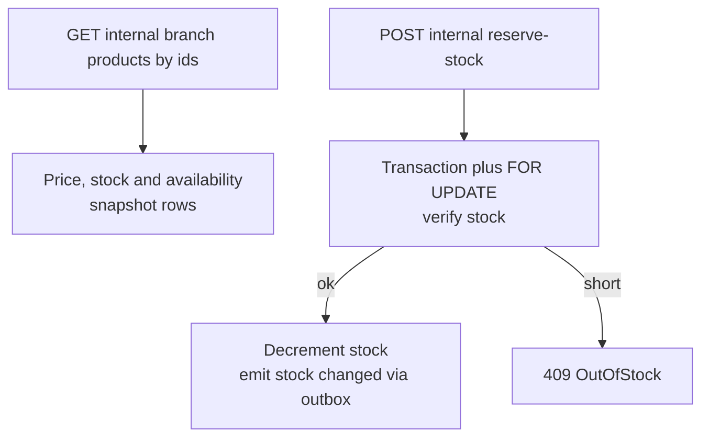

# QuickBite `core-service` — Product Business Logic

The catalog (categories, products, per-branch price/stock/availability) lives in `src/app/product` (`service/product.service.ts`). Products belong to a restaurant; sellable state belongs to a branch.

## 1. Catalog Model

- A DB trigger (`trg_product_after_insert`) auto-creates a `product_branch_details` row (`price 0, stock 0, unavailable`) in **every branch of the restaurant** when a product is inserted — new products are never accidentally sellable.
- Soft delete: `products.deleted_at` hides products from `findProductById` and branch listings while preserving history.

## 2. Endpoint Flows

### 2.1 Storefront (public)

### 2.2 Management (auth plus RBAC)

Outbox events are written **inside the same transaction** as the branch-details update — they
commit together or not at all. The field split matters to order-service: a `price` change emits
`product.price.changed` only; `stock` and/or `isAvailable` emit `product.stock.changed` carrying
both new values.

### 2.3 Internal (order-service checkout)

Rules:
1. **Categories are free-form but deduplicated.** `categoryName` on create/update finds-or-creates the category within the restaurant (`product.service.ts:67`).
2. **Stock reservation is atomic.** `reserveStock` locks the branch rows `FOR UPDATE`, rejects the whole batch on any shortfall, decrements, and writes a `product.stock.changed` outbox event per item in the **same** transaction — order-service invalidates its cache from these events.
3. **Update without `branchId` returns product only** (no `branchDetails` key); with `branchId`, branch overrides apply only to supplied `price|stock|isAvailable` fields.
4. **Every sellable-state change is published via the transactional outbox** (`docs/system-design/event-driven-architecture.md`):
   - `product.price.changed` on a price override (`product.service.ts:137`) — payload `{branchId, productId, newPrice}`.
   - `product.stock.changed` on stock or availability override (`product.service.ts:145`) — payload `{branchId, productId, newStock, isAvailable}`.
   - `product.stock.changed` per applied item of a stock reservation (`product.service.ts:213`).
   - `event_id` is minted at insert and travels unchanged to order-service (its dedupe key); consumers must be order-tolerant and idempotent (at-least-once delivery).
